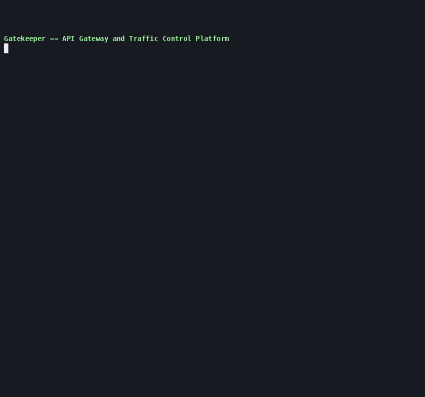
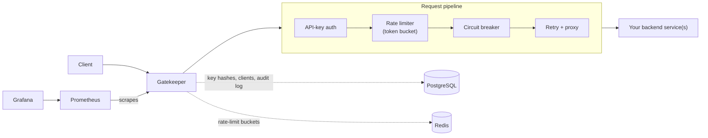

# Gatekeeper -- API Gateway and Traffic Control Platform

Gatekeeper is a production-style API gateway that sits in front of your
backend services and centralizes the traffic-control concerns every
service-to-service boundary ends up needing: who's allowed to call this,
how much are they allowed to call it, what happens when a backend is slow
or down, and can we actually see what's going on. It's a single FastAPI
application (no microservices sprawl) backed by Redis and PostgreSQL, and
the whole stack -- gateway, databases, demo backends, and a Prometheus +
Grafana observability stack -- runs locally with one `docker-compose up`.



*Recorded against the actual running stack with [`scripts/demo.sh`](scripts/demo.sh) -- see [`scripts/record_demo.sh`](scripts/record_demo.sh) to regenerate it.*

## What it does

- **Routes and proxies** requests to one or more backend services, based
  on a declarative, validated config file -- clients can never reach an
  arbitrary upstream.
- **Authenticates** every call with an API key (`X-API-Key`), issued and
  revoked through an admin API. Only a salted hash of the key is ever
  stored; the raw secret is shown exactly once, at creation time.
- **Rate limits** per client and per route using a Redis-backed token
  bucket, atomically enforced across however many gateway replicas you
  run, with tiered quotas (`free` / `standard` / `premium`) and a
  configurable burst allowance.
- **Retries** safe (idempotent) requests with jittered exponential
  backoff, and **trips a circuit breaker** per upstream after repeated
  failures -- so one unhealthy backend doesn't take the whole gateway down
  with it, and clients get an immediate, honest `503` instead of waiting
  on a doomed request.
- **Tags every request** with a correlation ID, propagates it to the
  upstream and back, and logs structured JSON with method, route, status,
  duration, and outcome -- so one request can be traced end to end.
- **Exposes Prometheus metrics** (throughput, latency, rejections, retries,
  circuit-breaker state, dependency health) and ships a provisioned
  Grafana dashboard for them.
- **Fails safely**: a malformed config refuses to start rather than run
  half-configured; a Redis outage rejects traffic by default
  (`fail_closed`) rather than let it through unmetered; every error the
  gateway itself produces comes back as `{"error": {"code", "message",
  "request_id"}}`, distinct from whatever an upstream itself returned.

## How it works



A request that reaches the gateway goes through, in order: route
resolution (longest-prefix match against `config/routes.yaml`, 404 if
nothing matches), API-key authentication against PostgreSQL, the token-
bucket rate-limit check against Redis (both a per-client-tier bucket and a
per-route bucket), a circuit-breaker check for that route's upstream, and
finally the proxied HTTP call itself -- retried with backoff if it's a
safe method and the failure looks transient. Every one of those steps can
reject the request with a specific, typed error; none of them can be
skipped by a client.

The full design rationale -- why a token bucket over a sliding-window
counter, why the circuit breaker is per-process rather than
cluster-coordinated, how retries interact with rate limits so they can't
turn into a retry storm, and known limitations (no response streaming, no
idempotency keys) -- is written up in
[`docs/architecture.md`](docs/architecture.md).

## Quickstart

```bash
git clone <this repo> && cd RateLimiting
cp .env.example .env            # edit the generated passwords

docker-compose build
docker-compose up -d postgres redis healthy-service slow-service flaky-service
docker-compose run --rm gatekeeper alembic upgrade head
docker-compose up -d gatekeeper nginx prometheus grafana

# bootstrap an API key
curl -s -u admin:$(grep GATEKEEPER_ADMIN_PASSWORD .env | cut -d= -f2) \
  -X POST http://127.0.0.1:8000/admin/api-keys \
  -H "Content-Type: application/json" \
  -d '{"client_name": "demo-client", "tier": "standard"}'

# call it through the gateway
curl -H "X-API-Key: <api_key from above>" http://127.0.0.1:8000/api/users/42
```

Or run the full scripted walkthrough shown in the recording above:
`./scripts/demo.sh` (against a running stack).

| Service | URL |
|---|---|
| Gateway API docs (OpenAPI) | http://127.0.0.1:8000/docs |
| Gateway (direct) | http://127.0.0.1:8000 |
| Gateway (via Nginx edge demo) | http://127.0.0.1:8080 |
| Prometheus | http://127.0.0.1:9090 |
| Grafana | http://127.0.0.1:3000 |

## What's in the box

- **Gateway** (`gatekeeper/`): FastAPI app -- routing, auth, rate
  limiting, retries, circuit breaking, metrics, admin API.
- **Demo upstreams** (`demo_upstreams/`): a healthy echo service, a
  service with a configurable response delay (for timeout testing), and a
  service that deliberately fails on a schedule or on demand (for
  retry/circuit-breaker testing).
- **Config** (`config/routes.yaml`, `config/policies.yaml`): the single
  source of truth for route definitions and rate-limit tiers -- validated
  with Pydantic at startup; a malformed file fails fast with an actionable
  error instead of starting in a half-broken state.
- **Migrations** (`migrations/`): Alembic, against PostgreSQL.
- **Observability** (`monitoring/`): Prometheus scrape config + a
  provisioned Grafana dashboard (throughput, error rate, latency
  percentiles, rate-limit rejections, circuit-breaker state, retries,
  dependency health).
- **Tests** (`tests/`): unit tests (no external deps) and integration
  tests (real Redis + Postgres via `scripts/run_integration_tests.sh`).
- **Load test** (`locustfile.py`): steady / bursty / chaos traffic shapes.
- **CI** (`.github/workflows/ci.yml`): lint, type-check, security scan
  (Bandit + pip-audit + Trivy), unit tests, integration tests, Docker
  builds -- all green on every push.

## Local development (without Docker)

```bash
uv venv -p 3.12 .venv
source .venv/bin/activate
uv pip install -p .venv -e ".[dev]"

pytest tests/unit -v
ruff check gatekeeper demo_upstreams tests
mypy gatekeeper
```

Running the gateway itself outside Docker still needs a real Redis and
Postgres reachable at the URLs in your `.env` (or override
`GATEKEEPER_REDIS_URL` / `GATEKEEPER_DATABASE_URL`):

```bash
uvicorn gatekeeper.main:app --reload --port 8000
```

## API-key authentication, in short

- `POST /admin/api-keys` (HTTP Basic, admin-only) issues a key. The full
  secret is returned **exactly once** and only its HMAC-SHA256 digest is
  ever persisted -- the database never holds a recoverable secret.
- Clients send the key as `X-API-Key: gk_<key_id>_<secret>`.
- Keys belong to a client with a tier (`free` / `standard` / `premium`)
  that determines its rate-limit quota, and can be revoked or set to
  expire.
- See [`docs/architecture.md`](docs/architecture.md#rate-limiting-algorithm-and-trade-offs)
  for how tiers map to Redis token buckets.

## Documentation

- [`docs/architecture.md`](docs/architecture.md) -- design, the
  rate-limiting algorithm and its trade-offs, and known limitations.
- [`docs/testing.md`](docs/testing.md) -- how to run the unit, integration,
  and load test suites.
- [`docs/runbook.md`](docs/runbook.md) -- day-to-day operation and
  incident diagnosis.

## License

See [`LICENSE`](LICENSE).
