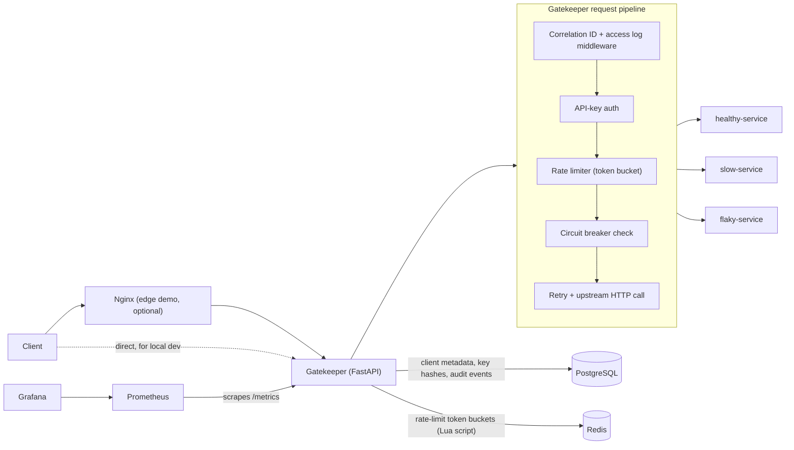

# Gatekeeper Architecture

## Overview

Gatekeeper is a single FastAPI application (no microservices) that sits in
front of one or more backend services and centralizes:

- API-key authentication
- per-client and per-route rate limiting (Redis-backed token bucket)
- request/response timeouts, retries, and circuit breaking per upstream
- request correlation IDs and structured logging
- Prometheus metrics and health/readiness probes

## Component responsibilities

| Component | Responsibility |
|---|---|
| `gatekeeper/routers/gateway.py` | Client-facing catch-all proxy endpoint |
| `gatekeeper/routers/admin.py` | API-key/client management (HTTP Basic auth) |
| `gatekeeper/routers/health.py` | Liveness, readiness, non-sensitive diagnostics |
| `gatekeeper/proxy/router.py` | Orchestrates route resolution, rate limits, retries, breaker |
| `gatekeeper/proxy/circuit_breaker.py` | Per-upstream, in-process circuit breaker |
| `gatekeeper/proxy/retry.py` | Retry policy (idempotent methods, bounded attempts, jittered backoff) |
| `gatekeeper/proxy/upstream.py` | The actual HTTP call: header filtering, size limits, error mapping |
| `gatekeeper/rate_limit/limiter.py` | Redis-backed token-bucket rate limiter |
| `gatekeeper/auth/` | API-key generation/hashing/verification, admin auth |
| `gatekeeper/db/` | SQLAlchemy models and async session management |
| `gatekeeper/routing_config.py` | Loads/validates `config/routes.yaml` and `config/policies.yaml` |

## Rate limiting: algorithm and trade-offs

Gatekeeper uses a **token bucket**, implemented as a single atomic Redis
Lua script (`gatekeeper/rate_limit/lua/token_bucket.lua`), rather than a
fixed or sliding-window counter.

- **Fixed window counters** are simple but allow up to 2x burst at window
  boundaries (full quota at `11:59:59` and again at `12:00:00`).
- **Sliding window counters** fix that but need to store a log of
  timestamps (or an approximation like sliding-window-counter-with-weighted-
  previous-window), which is heavier on Redis memory per key at high
  request volume.
- **Token bucket** gives smooth sustained-rate enforcement
  (`refill_rate_per_sec`) *and* an explicit, independently-tunable burst
  allowance (`capacity` + `burst`), which maps directly onto the
  tiered-quota requirement. It stores exactly two numbers (tokens,
  last-refill-timestamp) per key, so memory per client is O(1) regardless
  of request volume.

The refill/consume read-modify-write runs as one `EVAL` call, which Redis
executes atomically with respect to every other client connected to it.
That atomicity is what prevents multiple gateway replicas from each
independently granting a client the full quota -- a naive
`GET tokens; compute; SET tokens` from Python would race under concurrency
and over-admit traffic (verified under test:
`tests/integration/test_rate_limit_integration.py::test_concurrent_requests_never_exceed_the_configured_quota`
fires 100 concurrent requests against a 20-token bucket and asserts exactly
20 are admitted).

Buckets are keyed as:
- `ratelimit:tier:{api_key_id}` -- the client's overall tier quota
- `ratelimit:route:{api_key_id}:{route_scope}` -- a per-route-scope quota

A request must pass **both** checks. Idle bucket keys get a 1-hour Redis
`EXPIRE` so clients that show up once and never return don't grow Redis
memory forever.

### Fail-open vs. fail-closed

If Redis is unreachable, `GATEKEEPER_RATE_LIMIT_FAIL_MODE` controls what
happens:

- `fail_closed` (**default**): reject the request with `503
  DEPENDENCY_UNAVAILABLE` rather than risk an upstream being overwhelmed by
  unbounded, unmetered traffic. Safety-biased.
- `fail_open`: let the request through without rate limiting, with a
  `degraded=true` marker visible internally. Availability-biased; only use
  this if your upstreams can absorb unmetered load during a Redis outage.

## Retries, timeouts, and their interaction with rate limits

- Only **idempotent** HTTP methods (`GET`, `HEAD`, `OPTIONS`, `PUT`,
  `DELETE`) are retried, and only when the route's retry policy is
  enabled. `POST`/`PATCH` are never auto-retried, since without an
  idempotency-key mechanism (not implemented -- see Known Limitations)
  replaying them could duplicate a side effect.
- Backoff is exponential with full jitter:
  `uniform(0, min(backoff_max_seconds, backoff_base_seconds * 2**attempt))`.
- `max_attempts` bounds how many upstream calls a single client request
  can generate, which is the retry budget: it prevents one slow/failing
  client request from turning into a retry storm against an already
  struggling upstream. Critically, a client is charged exactly **one**
  rate-limit token for the whole attempt chain (the token is consumed
  before the first attempt) -- retries are an internal reliability
  mechanism, not a way to get extra throughput past the limiter.
- Each route has independent `connect`/`read`/`write`/`pool` timeouts
  (`config/routes.yaml`), so a slow backend can't stall the whole gateway.

## Circuit breaker

Each upstream route gets its own in-process `CircuitBreaker`
(closed → open → half-open → closed/open), with configurable
`failure_threshold`, `cooldown_seconds`, and `half_open_max_calls`. See
`gatekeeper/proxy/circuit_breaker.py` for the state machine and
`tests/unit/test_circuit_breaker.py` for behavior under a fake, manually
advanced clock (no real sleeps in tests).

**This breaker is local to each gateway process.** A fleet of N replicas
needs roughly N times the failures to all independently trip open, and
during that window some fraction of traffic still reaches a known-bad
upstream. This is a deliberate scope decision: a shared (e.g.
Redis-backed) breaker would need its own consistency model -- how quickly
state propagates, what happens if the coordination store itself is
unavailable -- and would add a network round trip to the hot path for
every single request's breaker check. For this project's scale, a
fast, correct, per-process breaker was judged the better trade-off.
Cluster-wide coordination would be the natural next step if this needed
to scale to many replicas behind a load balancer with a fast-moving
incident.

## Known limitations

- **No streaming responses.** The upstream response body is fully
  buffered (up to `GATEKEEPER_MAX_RESPONSE_BODY_BYTES`) before being
  returned to the client. This keeps size-limit enforcement and retry
  logic simple but makes Gatekeeper unsuitable for large file downloads or
  Server-Sent-Events/chunked streaming use cases as currently written.
- **No per-request idempotency keys.** This is why `POST`/`PATCH` are
  never retried automatically; adding an idempotency-key mechanism would
  let non-idempotent requests be retried safely.
- **Circuit breaker is per-process**, as discussed above.
- **Routing is prefix-based only** (longest-prefix-match); there's no
  support for header-based or weighted/canary routing.
